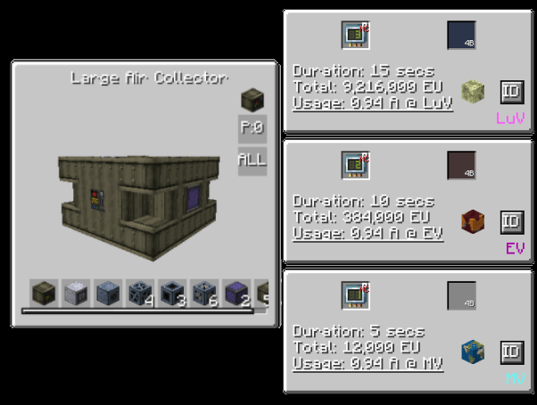
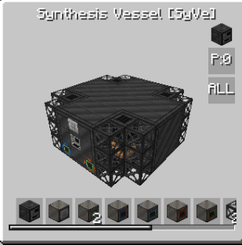
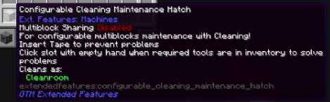
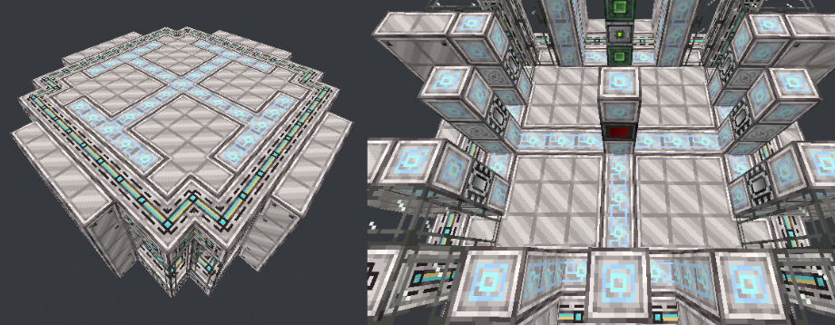
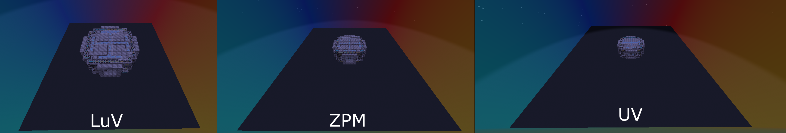

# Version 2.4.0

## Main changes

AFRs (Advanced Fusion Reactors) and `TIERED_PARALLEL` (also with `TIERED_TOOLTIP`) were removed due to gameplay balance concerns.

Greenhouse recipe times were reduced: normal recipes now take 16 seconds, and boosted recipes take 12.5s.

New multiblock: **Large Gas Collector [LGC]**.

A few changes were made in Synthesis Vessel structure adding heat vents and a `shapeInfo` to reflect (any)coils placement

**New addition:** Configurable Cleaning Maintenance Hatch — basically a configurable maintenance hatch for cleanroom recipes.

**Cloud Transmission Database** was renamed to **Matrix Data Relay**.

## Internal changes

**Custom parallels**: Previous versions required `MACHINE_PARALLE.apply(int parallels)`, this version changed that to `MACHINE_PARALLEL(int parallels)`

`MAX_CUSTOM_PARALLEL` parameter removed — by default the max value an `int` can take is `2147483647` _(just 2^31-1)_.

Wireless Optical Transmitters/Receivers have been renamed to Wireless Optical Transmissors/Receptors.
Range display range renders have been completely changed from the particle display;
it now has a Dynamic Render display based on the max distance of each transmissor.

- ZPM and UV scan range have been modified:

|    Old range    |   New Range    |
|:---------------:|:--------------:|
| ZPM Transmissor | UV Transmissor |
|       24        |       32       |
|       32        |       64       |

- Removed "`OPTICAL_TAB`" in favor of putting most singleblock features inside a single
  creative tab.
