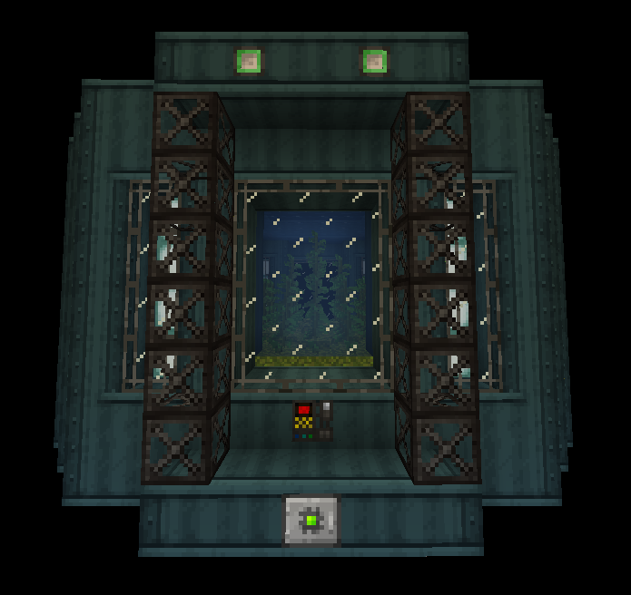
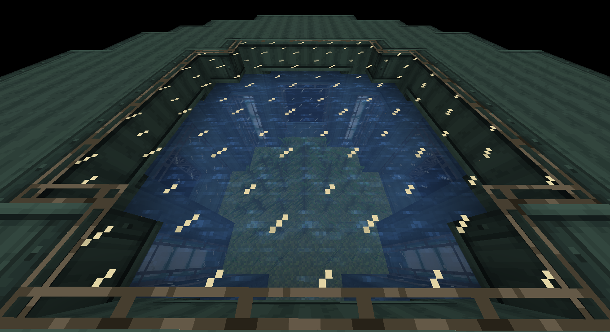
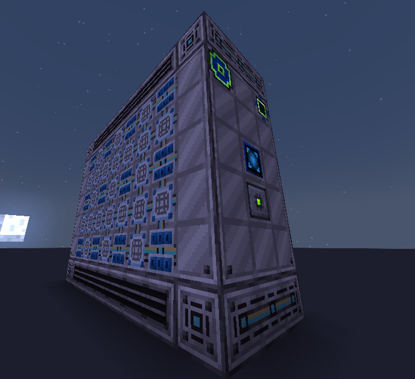
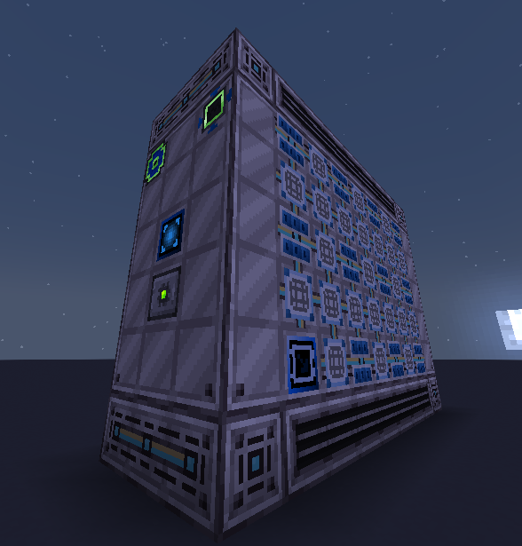
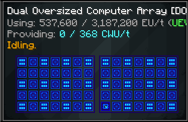
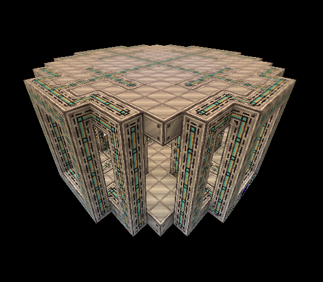
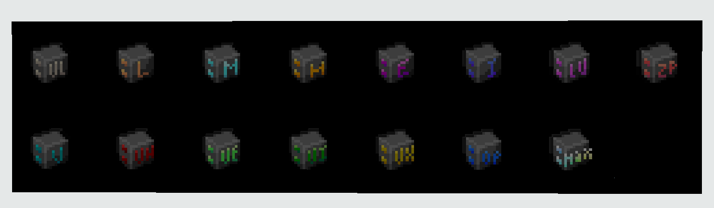

# Version 4.0.0

!!! danger "¡API Breaking update!"
    Some important files have been moved into different folders, signatures/functions/classes names changed. Make sure to check all changes if you ever used them somewhere in your code

## Multiblocks

### New additions
### Large Fisher [LF]

Allows an easier way to obtain large amounts of *fih's*

### Dual Oversized Computation Array [DOCA]

A huge upgrade for the High Performance Computation Array 

The best setup using GTCEu Base HPCA Components allows the following stats:

1. 368 CWU/t
2. Cooling Demand & Available: 92
3. 368 mB PCB Coolant
4. Bridging enabled

### **Matrix Data Relay:**

1. Added custom machine interface

    

2. Added `FADE IN` & `FADE OUT` effects for range display with a 1s cooldown to avoid spam

3. Final structure rework

    
    

## Multiparts

**Wireless Optical Transmissors:** Independent interface has been moved into the Matrix Data Relay controller, with this, they are now a multipart exclusive of the MDR

**CCM Hatch:** Fixed small crash for not having an *IS_TAPED* property + added its respective overlay when taped

## Items

Replaced **Witherschat Universal Circuits Textures** with **Diggypt_ textures**

## Miscellaneous Changes

1. Removed Jade integration
2. Added integration with GTCEu Terminals for Part Upgrading with Wireless Optical T/R
3. Fixed SyV tooltip saying it allows parallels when the structure does not allow them explictly
4. Renamed `Machines` to `MultiParts` (these are not machines whatsoever)