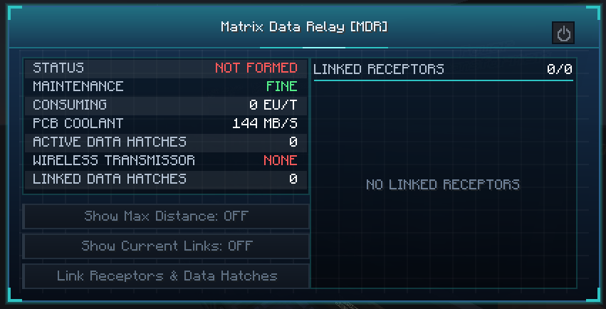
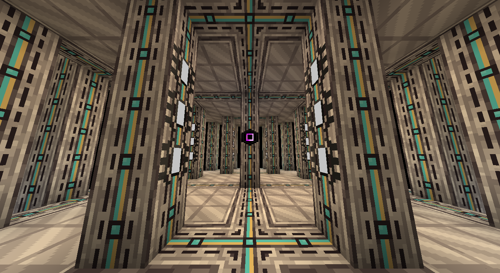

# Version 4.0.0

!!! danger "¡API Breaking update!"
    Some important files have been moved into different folders, signatures/functions/classes names changed. Make sure to check everything if you used them anywhere

## Multiblocks

### New addition: Large Fisher [LF]

Allows an easier way to obtain large amounts of *fih's*

### **Matrix Data Relay:**

1. Added custom machine interface

    

2. Added `FADE IN` & `FADE OUT` effects for range display with a 1s cooldown to avoid spam

3. Final structure rework

    
    

## Machines

**Wireless Optical Transmissors:** Independent interface has been moved into the Matrix Data Relay controller, with this, they are now a multipart exclusive of the MDR

## Items

Replaced **Witherschat Universal Circuits Textures** with **Diggypt_ textures**

## Miscellaneous Changes

1. Removed Jade integration
2. Added integration with GTCEu Terminals for Part Upgrading with Wireless Optical T/R
